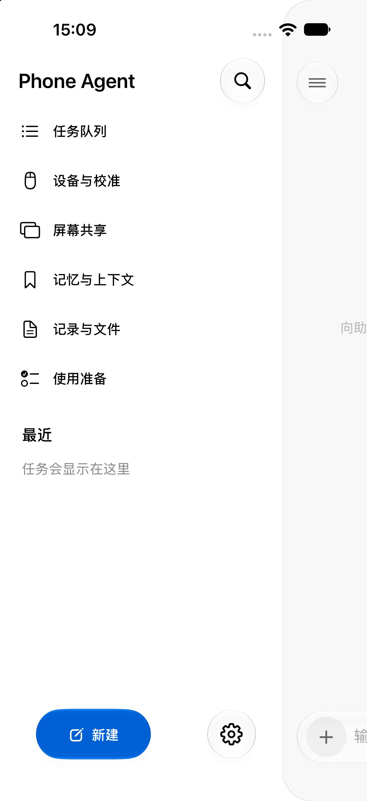

# Phone Agent

原生 iPhone AI 助手，配合 ESP32-C3 / ESP32-S3 蓝牙鼠标与键盘配件，根据共享画面执行手机任务。当前源码版本：**1.0 / Build 67**。Swift 工程已按 GestaltEdit 的职责划分与同步文件夹方式整理，详见 [源码结构](docs/architecture.md)。

## 功能

- **操控手机**：观察共享画面、生成并校验动作、通过 BLE 配件执行、重新观察结果；支持暂停、停止、接管、补充和任务队列。
- **问助手**：文字、听写、画面与相机提问，提供单独配置的实时语音入口。
- **配件**：鼠标、ASCII 键盘与快捷键，21 步指针校准；每个新目标先回到左上角，再沿直线移动。
- **工具**：联网检索、记忆、文件与录音管理、会议纪要、鱼骨图和表格。
- **系统集成**：Siri / 快捷指令、实时活动和动作画中画；实际可用性由系统权限、设备和运行状态决定。
- **界面**：SwiftUI Liquid Glass、浅色／深色外观，侧栏功能直接排列；两种模式的底部按钮均显示“新建”。

## 快速开始

环境：**Xcode 27、iOS 27 SDK、ESP-IDF 5.5.4**。真机签名需选择自己的 Apple Developer Team。

```sh
git clone https://github.com/boboabw/phone-agent.git
cd phone-agent
open PhoneAgent.xcodeproj
```

模拟器编译：

```sh
xcodebuild -project PhoneAgent.xcodeproj -scheme PhoneAgent \
  -configuration Debug -destination 'generic/platform=iOS Simulator' \
  -derivedDataPath build/ios CODE_SIGNING_ALLOWED=NO build
```

在已配置 ESP-IDF 的终端编译配件：

```sh
bash scripts/build-firmware.sh esp32s3
# 或：bash scripts/build-firmware.sh esp32c3
```

在 App 设置中填写服务商的完整 **HTTPS Chat Completions URL**、模型 ID 和自己的 API Key。屏幕操控需要支持图像输入的模型。API Key 由 App 保存在 iPhone 钥匙串中。

详细步骤见 [配置与运行](docs/setup.md)、[固件与烧录](docs/firmware.md)。

## 目录

| 路径 | 内容 |
| --- | --- |
| `PhoneAgent/` | App 入口、ContentView、ViewModel；按页面、服务、存储和外观分目录 |
| `Shared/` | 动作协议、校准、任务与工具数据模型 |
| `Activity/` | 实时活动扩展 |
| `Skills/` | 手机操控规则与 Apple 官方帮助索引；作为 App 资源打包 |
| `firmware/` | NimBLE HID 与控制服务、鼠标轨迹、键盘及 RGB 状态灯 |
| `Tests/` | 已有离线协议、产品状态和 Skill 打包检查 |
| `scripts/` | 检查与双芯片固件构建入口 |
| `docs/` | 使用、架构、固件和验证说明 |

## 检查

```sh
bash scripts/check.sh
# 已编译 App 时，另检查内置 Skill 资源：
bash scripts/check.sh build/ios/Build/Products/Debug-iphonesimulator/PhoneAgent.app
```

这些检查不需要手机、模型接口或 BLE。检查范围和结果见 [验证说明](docs/verification.md)。

## 运行边界

App 使用用户授权的整屏共享和辅助触控 HID；系统共享选择器、权限和解锁由用户完成。模拟器可查看界面与部分状态流程，不能代替 BLE、Siri、相机、画中画和跨 App 执行的真机验证。iOS 暂停或结束进程后，不能保证持续后台执行或常驻语音唤醒。

模型与检索请求发送到用户配置和授权的服务商；不要将 API Key、证书、配对备份或手机数据提交到 Git。仓库只包含源码、图标和一张当前界面预览。


